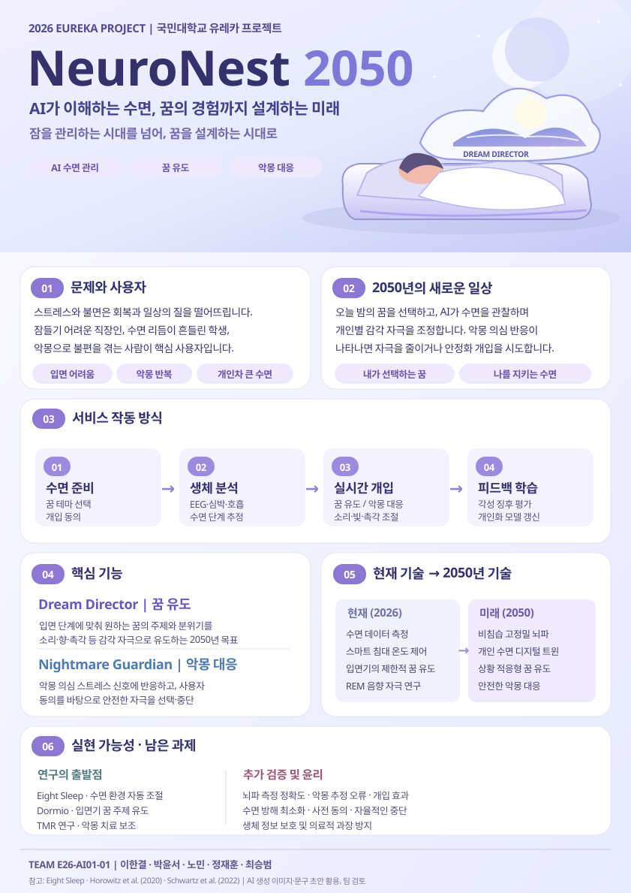

# ☾ NeuroNest 2050

### 잠을 관리하는 시대를 넘어, 꿈을 설계하는 시대로.

**2026 국민대학교 유레카 프로젝트 · AI01 1팀**

AI가 생체 신호를 분석해 수면 환경을 조절하고, 2050년에는 꿈 유도와 악몽 대응까지 돕는 **개인 맞춤형 스마트 침대**를 제안합니다.

[**프로젝트 홈페이지**](https://kookmin-sw.github.io/E26-AI01-01/) · [**⛶ 포스터 발표 모드**](https://kookmin-sw.github.io/E26-AI01-01/poster/present.html) · [**참고자료 및 AI 활용**](docs/references.md)

포스터를 클릭하면 발표 모드로 이동합니다. ← → 순서 이동 · F 전체화면 · 0 전체 보기 · 휠 확대 · 드래그 이동

---

## 1. 프로젝트 소개

**NeuroNest 2050**은 스트레스와 불면으로 잠들기 어려운 사람, 악몽으로 수면의 질이 떨어지는 사람에게 개인 맞춤 수면 환경을 제공하는 미래형 AI 수면 플랫폼입니다.

기본 아이디어는 **개인의 수면 데이터 학습 → 상태 추정 → 맞춤형 환경 제어 → 반응 평가 → 다음 날 개선**이라는 폐회로(Closed-loop) 구조입니다. 이 위에 현재는 초기 연구 단계인 꿈 주제 유도 기술을 미래형 서비스로 확장합니다.

> **2050년 미래 비전:** 오늘 밤 “바닷가에서 쉬는 꿈을 꾸고 싶어”라고 말하면, 수면 단계에 맞춰 소리·향·촉각 자극을 조절하고, 악몽과 관련된 스트레스 징후가 나타날 경우 사전 동의에 기반한 안정화 개입을 시도하는 침대.

### 핵심 기능

| 기능 | 구상 |
|---|---|
| **AI 수면 관리** | EEG·심박·호흡·움직임 등 생체 신호를 분석해 수면 상태를 추정하고 환경 조절 |
| **Dream Director — 꿈 유도** | 사용자가 선택한 꿈의 주제에 맞춰 감각 자극을 제공하는 미래 기능 |
| **Nightmare Guardian — 악몽 대응** | 악몽 *의심* 신호에 반응하고 안전한 개입 또는 중단을 선택하는 미래 기능 |
| **수면 디지털 트윈** | 개인별 수면 습관과 자극 반응을 학습하는 예측 모델 |

> **연구와 상상 구분:** 꿈의 내용을 완벽히 제어하거나 실시간으로 악몽을 확정 판독하는 기술은 현재 존재하지 않습니다. 위 기능은 2050년을 목표로 한 미래 설계이며, 불면증 치료 효과가 검증된 서비스가 아닙니다.

### 서비스 작동 방식

`사용자 설정·동의 → 생체 데이터 측정 → AI 수면 단계·반응 추정 → 감각 자극 및 환경 제어 → 결과 평가·개인화 학습`

### 검증해야 할 과제

1. 수면 중 불편하지 않은 **비침습 EEG 측정**이 가능한가?
2. 꿈 유도와 악몽 대응 개입이 **실제로 사용자에게 도움이 되는가?**
3. 수면 방해, 오류 감지, 과도한 자극을 어떻게 최소화할 것인가?
4. 민감한 뇌파·수면 데이터를 어떻게 보호하고, 사용자의 동의와 중단권을 보장할 것인가?

[연구 근거 및 AI 활용 내역 자세히 보기](docs/references.md)

---

## 2. 발표 자료

- **[발표 모드 열기](poster/present.html):** 전체화면, 구역별 확대, 순서 이동, 확대·축소 지원
- **[웹 포스터 원본 (SVG)](assets/neuronest/poster.svg):** 이미지 확대 시 글자가 깨지지 않는 벡터 형식
- **[프로젝트 웹페이지](index.html):** NeuroNest 주제와 핵심 기능을 설명하는 랜딩 페이지

**주의:** 본 저장소의 SVG는 발표·웹 게시용으로 새로 구성한 벡터 포스터입니다. 앞서 생성한 별도의 이미지 시안과는 다르며, 수업 제출용 최종 A0 PDF로 확정된 파일은 아닙니다. 기존 `poster.jpg`는 참고용 초기 샘플로 유지했습니다.

---

## 3. 팀원 소개

| 이름 | 전공 | 관심사 |
|---|---|---|
| 이한결 | 인공지능전공 | 보안, 프론트엔드, 백엔드, 인공지능 |
| 박윤서 | 인공지능전공 | 해외 인턴, 인공지능, 프론트엔드 |
| 노민 | 인공지능전공 | 분산 시스템, 데이터베이스, 오픈소스 |
| 정재훈 | 인공지능전공 | 알고리즘, 시스템 프로그래밍, 스타트업 |
| 최승범 | 인공지능전공 | UX/UI, 모바일 앱, 창업 |

### 팀 소개

AI·SW 기술에 관심을 가진 다섯 명의 학생이 함께 2050년의 미래를 상상합니다. 기술을 나열하는 데 그치지 않고 **사용자 문제 정의, 기술의 작동 원리, 기존 연구와의 연결, 윤리적 과제**를 함께 고민하며 미래의 서비스를 제안합니다.

### 팀 슬로건

> Imagine. Create. Evolve.

---

## 4. 유레카 프로젝트 활동 기록

기존 팀 자료는 삭제하지 않고 유지했습니다.

| 주차 | 활동 기록 |
|---|---|
| 1주차 | [Week_01.md](Week_01.md) |
| 2주차 | [Week_02.md](Week_02.md) |
| 3주차 | [Week_03.md](Week_03.md) |

수업 진행 과정에서 기관·부서 인터뷰, 현장 탐방, 멘토링, 미래 사회 기획 등의 활동을 통해 진로와 AI 시대의 변화를 탐구했습니다. 세부 경험은 팀원별 실제 활동 기록을 기준으로 추가 작성할 수 있습니다.

---

## 5. 참고자료 및 AI 활용

현재 상용 스마트 침대의 수면 환경 조절 기술, MIT Dormio의 꿈 주제 유도 연구, 악몽 관련 Targeted Memory Reactivation 연구를 참고하여 2050년 미래 기능을 제안했습니다.

**활용 도구:** ChatGPT, 이미지 생성 AI (콘셉트 이미지·구성·문구·웹 발표 코드 초안). 생성된 내용은 팀에서 출처와 정확성을 최종 검토해야 합니다.

[**참고자료 및 AI 활용 내역 전체 보기**](docs/references.md)

---

**NeuroNest 2050 · 국민대학교 유레카 프로젝트 · AI01 1팀**
